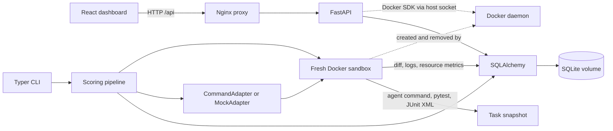

# AgentEval

AgentEval runs coding-agent evaluations in disposable Docker sandboxes, scores each task's pytest suite, and records outcomes by agent, model, prompt, and source revision.

Maintained by [Kapil Krishnan](mailto:Kapil.Krishnan@gmail.com).

## Features

- Evaluate configured coding agents against repeatable task snapshots.
- Run agent and test commands inside fresh, network-disabled Docker sandboxes.
- Track pass rates, test counts, diffs, latency, token usage, and estimated cost.
- Compare versioned runs with Fisher exact testing and Holm adjustment.
- Browse run history, task output, comparisons, and trends in a React dashboard.

## Quick Start

Requirements: Docker Desktop or Docker Engine with Compose v2 and a running Linux-container daemon. Compose binds the dashboard and API to `127.0.0.1` for local use.

Clone the repository and open a terminal in its root directory, then run:

```sh
docker compose up --build
```

Open the dashboard at [http://localhost:5173](http://localhost:5173); the API is at [http://localhost:8000](http://localhost:8000). The Compose build includes the API dependencies and pytest in the local sandbox image.

Run a deterministic smoke evaluation from a second terminal:

```sh
docker compose exec api agenteval run --agent /app/configs/mock-success.yaml --tasks /app/tasks --task-id ci-mock-smoke --repeats 5 --concurrency 2
```

Example output (run IDs, durations, and intervals vary):

```json
{"task_id":"ci-mock-smoke","run_ids":[1,2,3,4,5],"pass_at_1":1.0,"pass_rate":1.0,"pass_rate_ci95":[0.566,1.0],"median_latency_seconds":0.42,"total_estimated_cost_usd":0.00006}
```

Stop the stack with `docker compose down`. Persisted records remain in the named `agenteval-data` volume; remove it explicitly with `docker compose down -v` when you want to delete that data.

### Compare two versions

Run the second example version from another terminal:

```sh
docker compose exec api agenteval run --agent /app/configs/mock-success-v2.yaml --tasks /app/tasks --task-id ci-mock-smoke --repeats 5 --concurrency 1
```

In the dashboard, click **Refresh runs**, open **Compare**, and choose different labels in the baseline and candidate selectors. Both example configs use a successful mock adapter; this demonstrates comparison, not a coding-quality evaluation.

## Security and Intended Use

The Compose setup is for local development and binds the dashboard and API to `127.0.0.1`. The API has no authentication and mounts the Docker socket, which grants it substantial control over the host Docker daemon. Do not expose the API, dashboard, Docker socket, or this setup to untrusted users or networks. Review [SECURITY.md](SECURITY.md) and the sandbox threat model in [docs/DESIGN.md](docs/DESIGN.md) before adapting it for other environments.

Task manifests and configured agent commands are trusted operator input. Run only configurations you trust, and do not put credentials or secrets in task containers.

## Architecture



The CLI `run` command evaluates YAML task manifests through the scoring pipeline. The dashboard reads those records through `/scoring/runs`, `/scoring/runs/{id}`, `/scoring/compare`, and `/scoring/trends`. A separate direct-run API accepts registered JSON task specs: `tasks/sample-refactor/task.json` demonstrates that format; register it with `docker compose exec api agenteval register /app/tasks/sample-refactor/task.json`, then use `POST /tasks/sample-refactor/runs`. Browse the interactive API docs at [http://localhost:8000/docs](http://localhost:8000/docs). Direct-run records are separate from statistical scoring runs.

The API container talks to the host Docker daemon to create sandboxes; the sandbox itself receives neither the Docker socket nor host task mounts. The Compose ports bind to loopback for local use; this does not replace authentication or make remote access safe.

## Run and Compare

Agent configs are YAML. `configs/mock-success.yaml` demonstrates the vendor-neutral mock adapter. `configs/agent.example.yaml` is a template, not a ready-to-run agent: replace its command and image with a CLI and image you provide. The image must contain the agent CLI and pytest. The sandbox has no network, so dependencies must already exist in the image or task snapshot.

```sh
agenteval run --agent configs/agent.example.yaml --tasks tasks --repeats 10 --concurrency 3
agenteval compare agent-v1 agent-v2
agenteval report
```

The compare command uses a one-sided Fisher exact test for pass-rate drops and Holm correction across per-task comparisons. It exits with status `1` when the overall or any per-task comparison flags a significant regression, so it can gate CI. `--concurrency` bounds simultaneous task sandboxes; repetitions for each task remain sequential.

## Decisions and Limitations

- Docker provides the required isolation boundary. Each run gets a fresh container, network disabled by default, a read-only base filesystem, resource limits, and a writable tmpfs workspace populated and collected using Docker exec tar streams. Docker absence fails closed; task or agent code is never run on the host.
- Compose mounts the Docker socket into the trusted API service so it can manage sandboxes. This grants the API service substantial host control. Do not expose the API to untrusted users, or mount the Docker socket or pass credentials into task containers.
- SQLite and synchronous requests keep local use simple. SQLite is intended for a small, single-host harness, not high-volume concurrent workers or multi-tenant deployments.
- The mock benchmark validates accounting and regression-gate behavior, not coding quality. See [docs/RESULTS.md](docs/RESULTS.md) for the method and measured result.
- Version identities are labels supplied by the caller. Agent configuration and task image digests are not yet snapshotted into every run.
- JUnit results are summarized as passed/total counts. Flaky-test policy, statistical power planning, artifact retention limits, authentication, and VM-grade isolation remain deployment decisions.

## Development Checks

Backend checks (from `backend/`):

```sh
pytest
ruff check .
ruff format --check .
mypy src/agenteval
```

Dashboard checks (from `dashboard/`):

```sh
npm ci
npm test
npm run build
```

See [docs/DESIGN.md](docs/DESIGN.md) for the fuller design and threat model.

## License

This project is licensed under the [MIT License](LICENSE).
