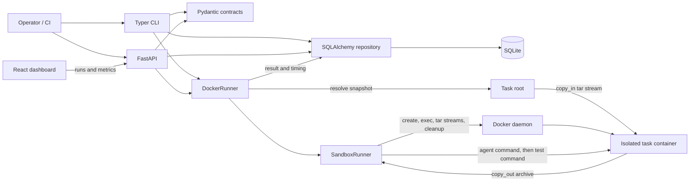

# AgentEval Design

## Goals

- Evaluate coding-agent work on repeatable bug-fix, feature, and refactor tasks.
- Run both agent and task test commands inside a hardened Docker container; never fall back to host execution.
- Record results with agent, model, and prompt versions so quality, cost, and latency can be compared across changes.
- Keep the first deployment simple to install and operate, while preserving clear interfaces for later worker and storage scaling.

## Non-Goals

- Implement or host a coding agent, model API, or prompt authoring environment. The initial harness accepts configured commands and version labels.
- Treat a task manifest as untrusted input. Manifests select images and shell commands and are trusted operator configuration.
- Provide multi-tenant authorization, a distributed scheduler, or high-availability storage in the initial single-process workflow.
- Claim that a Docker container alone is a complete security boundary against a compromised host kernel or daemon.
- Infer monetary cost from provider billing. Cost is supplied by the caller until provider-specific accounting is added.

## Architecture

The backend is organized around small contracts and boundaries. FastAPI and Typer provide HTTP and command-line entry points; both use the SQLAlchemy persistence functions and `DockerRunner`. The dashboard reads run history, aggregate metrics, and version-grouped metrics from the API. The current execution path is synchronous. The Compose deployment binds published ports to loopback; this is a local-development safeguard, not API authentication.

## Core Data Model

These are the logical domain concepts. The MVP does not yet persist each concept as its own table; the implementation mapping below is intentional and should remain explicit as the model evolves.

| Entity | Purpose and key fields | MVP representation |
| --- | --- | --- |
| **Task** | A stable ID, description, category (`bugfix`, `feature`, or `refactor`), repository snapshot path, setup commands, test command, timeout, and difficulty. | YAML manifests validated by the Pydantic `Task` schema. The current evaluator's `TaskSpec` and `tasks` table remain the execution-registration model; the five starter snapshots are catalog fixtures and are not yet wired into that runner contract. |
| **Agent** | The evaluated agent identity and immutable or traceable release/configuration. An evaluation should identify the agent, model, and prompt version independently. | No Agent table yet. `RunRequest` and `RunRecord` store `agent_version`, `model_version`, and `prompt_version` strings. A future registry can hold provider, command/template reference, and configuration digest. |
| **Run** | One attempt to evaluate one task with one agent/model/prompt/git combination. It owns lifecycle timing, status, and version references. | `scoring_runs` / `ScoringRunRecord` stores every scored repetition and its full version identity. The older `runs` table remains for the original CLI/API flow. |
| **Result** | The outcome of the agent and test phases: pass/fail/timeout, pytest counts, changed-line diff size and bounded unified patch, token usage, estimated cost, and setup/agent/test logs. | Stored directly on `scoring_runs`; each repetition appends its metrics, logs, and patch. |
| **Metric** | A derived measure over results, such as pass rate, mean cost, median latency, and statistically significant regression, optionally grouped by task and version. | Computed from raw `scoring_runs`. Regression uses one-sided Fisher exact tests; per-task p-values receive Holm correction. Trends aggregate daily run counts, pass rate, mean latency, and cost. |

The version strings are caller-provided labels, not proof that the underlying agent configuration is immutable. Reproducible comparisons ultimately require a configuration digest and a retained task/image identity.

## Component Responsibilities

- **Pydantic schemas (`schemas.py`):** Validate task, run request, outcome, run record, and metric contracts at system boundaries.
- **SQLAlchemy persistence (`database.py`):** Create the schema, upsert task definitions, append legacy and scoring run records, and query run history/details. SQLite is the default local store.
- **Metrics (`metrics.py`):** Calculate overall and version-grouped pass rate, average cost, and average latency from persisted runs.
- **Docker runner (`runner.py`):** Validate workspace containment, sequence agent and test commands, aggregate their results, and fail closed when Docker is unavailable.
- **Sandbox runner (`sandbox.py`):** Own one fresh container per run; expose `exec()`, `copy_in()`, `copy_out()`, and idempotent `cleanup()` operations; capture command output through Docker's attached exec stream and stream workspace archives from inside the container so tmpfs files are included; apply isolation/resource settings; enforce a shared monotonic deadline; and clean up after normal completion, failures, or timeout.
- **Agent adapters (`agent_adapters.py`):** Define vendor-neutral `AgentAdapter.run(task_workspace, instructions) -> AgentResult`; `CommandAdapter` runs a configured CLI command only through `SandboxRunner`, while `MockAdapter` provides deterministic success, failure, alternating flaky, and slow behaviors. Token and tool-call counts are parsed through a generic usage callback/marker, not provider-specific SDKs.
- **Scoring pipeline (`scoring.py`):** For each repeated attempt, opens a fresh sandbox, runs setup commands, snapshots the post-setup workspace, runs the agent, captures a bounded unified diff before tests, then runs pytest with JUnit XML written under `/workspace` for retrieval in the workspace tar stream; records test counts, elapsed time, token usage, estimated token cost, and bounded setup/agent/test logs. The configured sandbox image must have pytest preinstalled because networking is disabled during runs. It reports `pass_at_1` as first-attempt success, repeated-run pass rate with a Wilson 95% interval, median latency, and total estimated cost.
- **FastAPI (`api.py`):** Expose legacy health/task/run/metrics endpoints plus `/scoring/runs`, `/scoring/runs/{id}`, `/scoring/compare`, and `/scoring/trends` for persisted scoring data.
- **Typer CLI (`cli.py`):** Load a vendor-neutral YAML agent config, run task manifests with bounded task-level concurrency, compare unique version labels with CI exit gating, and print persisted reports.
- **React/Vite dashboard (`dashboard/`):** Display aggregate metrics, version comparisons, and filterable run history; it does not execute tasks.
- **Task suite (`tasks/`):** Supply manifests, source workspaces, and tests. Task content is mounted only into the container during evaluation.

## Sandbox Security Model

### Trust boundaries and flow

The task manifest and configured commands are trusted operator input, but the agent and task code executed by those commands are treated as untrusted. The host resolves the repository snapshot beneath the configured task root and streams it into a new container through Docker exec. It does not execute task code locally or bind-mount the host repository. Docker absence or daemon errors fail closed; there is no subprocess or host fallback.

The container is configured with:

- Network access disabled.
- A read-only base filesystem and container-local writable tmpfs mounts for `/workspace` and `/tmp`. The repository and JUnit XML are stored under `/workspace`; workspace contents are tar-streamed from the container so tmpfs files are included, while command output is collected through the attached exec stream.
- All Linux capabilities dropped and `no-new-privileges` enabled.
- A non-root numeric user, a PID limit, memory and CPU limits, and a bounded temporary filesystem mounted `noexec` and `nosuid`.
- A hard monotonic deadline shared across agent and test execution, forced stop/removal on timeout or error, Docker local log rotation, and bounded command output.

The task container must not receive the Docker socket, host credentials, or provider secrets. Each `SandboxRunner` owns a fresh container and removes it after the run, including constructor, copy, exec, and timeout failures. Container and daemon failures are surfaced as execution errors rather than causing host-side execution.

### Limits and operational requirements

This is defense in depth, not a claim of complete isolation. The Docker daemon and host kernel remain trusted; a daemon compromise can affect the host. Manifests control the selected image and command and therefore must be reviewed. Production use should run workers on dedicated, patched hosts, pin and allowlist images by digest, limit daemon access, isolate task data, and define cleanup and retention policies. The current MVP does not provide a custom seccomp profile, VM-grade isolation, image signature verification, or secret brokering.

## Milestone Plan

1. **MVP vertical slice (implemented):** Task manifest validation and registration; synchronous Docker execution; task-specific test verdict; SQLite run history; overall and version-grouped metrics; CLI, API, dashboard, and unit tests.
2. **Reproducible run identity:** Add explicit Agent/release records, immutable agent and prompt configuration digests, task revision or source commit, image digest, and structured Result details. Define schema migration/versioning before evolving stored records.
3. **Regression analysis:** Add selectable baselines, per-task and per-version comparisons, configurable regression thresholds, and clear treatment of repeated runs and flaky tests. Keep raw runs as the source of truth.
4. **Durable worker execution:** Move long-running evaluations behind a durable queue and worker lifecycle with cancellation, retries, idempotency, and persisted intermediate states. Keep the API contract independent of the queue implementation.
5. **Production isolation and operations:** Add image digest policy, isolated worker hosts, stronger sandbox profiles, concurrency quotas, log/artifact retention, audit events, and operational health signals. Validate the threat model against the actual deployment environment before enabling arbitrary task suites.

## Open Questions

- What is the authoritative identity of an Agent: a command template, provider adapter, executable build, or a complete immutable configuration snapshot?
- Should a task workspace be a checked-out repository commit, an uploaded archive, or a prebuilt image layer? How are fixtures and private dependencies supplied without leaking credentials?
- Which result semantics are required: command exit status only, structured test counts, partial credit, or task-specific scoring plugins?
- How should flaky tasks be handled: one attempt, fixed repeats, adaptive repeats, or a separately reported stability score?
- What is the source and precision of cost data, and should cost be recorded per run, per agent request, or both?
- What comparison baseline and alert policy should define a regression? Should thresholds be global, per task, or statistically confidence-based?
- What expected run volume, concurrency, and retention period will trigger moving from SQLite and synchronous execution to a shared database and durable workers?
- What container runtime, host isolation, image trust policy, and threat level are required for the intended deployment?

## Trade-Offs

- **Docker SDK instead of host subprocesses:** Docker adds daemon, image, and worker-host requirements, but keeps untrusted commands behind the required execution boundary. A host fallback is explicitly rejected.
- **SQLite instead of PostgreSQL:** SQLite keeps local setup compact and fits the current single-process workflow. PostgreSQL becomes preferable for concurrent workers and shared deployments.
- **Synchronous execution instead of a queue:** Synchronous runs keep the MVP easy to operate and reason about. They occupy an API/CLI process for the full run and are not a durable scheduling mechanism; a persistent queue is deferred to the worker milestone.
- **Version labels instead of an Agent registry:** Free-form strings avoid coupling the MVP to a specific provider. They are easy to mistype and do not guarantee reproducibility; immutable configuration identities are planned.
- **Derived metrics instead of stored aggregates:** Querying from raw run records avoids stale counters and keeps the history authoritative. It may become expensive at scale; cached or materialized aggregates can be added with explicit invalidation rules.
- **Docker tar-stream copy into tmpfs instead of a host bind mount:** Copying protects the task source from agent changes and avoids exposing a host path inside the container. It costs transfer time and container memory; task-size limits and copy-out artifact limits should be established before large repositories are accepted.
- **One combined agent/test container instead of separate phases:** The MVP preserves the same task filesystem from agent changes through test execution and has a smaller lifecycle. It does not provide a clean-room test phase; a future design may snapshot the agent output and run tests in a fresh container if stronger phase isolation is needed.
